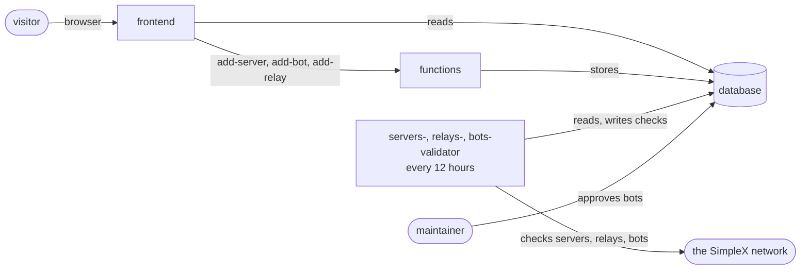

# Design

How the catalog is built: its components, what each is responsible for, the rules every change keeps, and where code goes. The stories (`stories/README.md`) say what the catalog does; this says what does it. Read it before changing code: its rules hold for every change, inside a stage or not.

## Overview

The catalog is six components, each deployed on its own.



- **frontend** is the website. It reads what the catalog knows from the database and asks the functions to add what a visitor submits.
- **database** is the Supabase project's Postgres, with PostgREST in front of it: the tables, the views that compute what the website shows, and the rules on who may read and write them.
- **functions** are the project's three edge functions, which take what a visitor submits and store it in the database.
- **servers-validator**, **relays-validator** and **bots-validator** are programs run by GitHub Actions every 12 hours. Each takes the list of what it checks from the database, checks every item over the SimpleX network, and writes the result back as a new check.

### Rules
These hold for every change.

1. **The components meet only at the database and the functions.** The frontend and the validators do not call one another, and the functions are called by the frontend only: the others read and write the database, which calls none of them.
2. **A visitor reads the database, and writes only by the three functions.** Every table has row level security, with a policy for reading and none for anything else, so the public key can read what the policies let it and change nothing. What writes (the functions, the validators) does it with the project's secret key.
3. **A check is appended.** Every check adds a status; the history and the uptime are computed from the statuses. No component deletes a status. Removing what has been inactive for 90 days is the maintainer's act in the Supabase project.
4. **What the website shows of an item is derived, not stored.** The latest status and the uptime are computed from the statuses, the uptime in the views; the profile of a bot or a relay is a row of its own, which a check that read one replaces.
5. **The approval of a bot is the database's to enforce, not the frontend's.** The policies of `bots` and of every table that hangs on a bot, and the bots' view, show nothing of a bot that is not approved, and the bots validator asks for approved bots only.
6. **What a visitor keeps is the browser's.** The filters last used and the server labels are in the browser's storage; the database knows nothing of a visitor.
7. **A component's logic reaches outside only through its ports.** Every component has ports of its own (traits in the validators, TypeScript interfaces in the website and the functions): inbound ones, how it is driven (the website's pages, a validator's program, a function's HTTP handler call them, and its logic implements them), and outbound ones, what its logic needs from outside, shaped by what the logic needs and not by what is behind them. Adapters implement the outbound ones, and only the adapters and the place that wires them (the website's `main.ts`, a validator's program, a function's HTTP handler) touch what is outside: the database's and the functions' client, error reports and analytics, the browser's storage, clipboard and files, the network, the SimpleX CLI, the GeoIP database. An architecture check holds each component to it, on its source.
8. **A port says in what it gives all that can come of it.** It never throws, rejects or panics: what can fail gives a result that says so (`Result` in the website and the functions, `Option` in the validators, `None` when the outside could not be asked), and an adapter catches what is thrown behind it. What a port finds is a type of its own (online or offline, accepted or not), never a nested `Option` or a bare `null` that means two things. A port that gives a list is asked for a page of it and gives that page with how many the list holds in all (`Page`, `PageOf`), so no list is cut short where nobody sees it; a caller that needs all of it reads every page.
9. **The SimpleX CLI and the gateway are part of a validator.** They are deployed with it and are not a component of the catalog. What a validator reaches through them is the SimpleX network, and the overlay networks (Tor, I2P, Yggdrasil) are the gateway's.
10. **A migration that changes what the frontend, the functions or a validator uses is part of the same change as their code.**

## Components

### frontend
The website, a single-page application in Svelte, published to GitHub Pages.

It is responsible for the pages, their routes and the menu and footer; for reading the lists and the history of servers, bots and relays from the database and showing them; for what a list does with what it read (the servers' filtering, sorting and paging are the browser's, because a server's status, country and info page come from its latest check and the labels are the visitor's; the bots' and relays' are the database's, asked for by the query); for the visitor's filters and labels, their import and export, and bulk mode; for asking the functions to add what a visitor enters and telling the visitor the answer; for the map of the servers' countries; and for the optional error reports and analytics.

It is not responsible for checking anything, for deciding what is a valid address (the functions do), for computing uptime (the views do), or for knowing which bots are approved (the policies do).

It interacts with the database, which it reads, and with the three functions, which it calls, both through the public key.

Its ports: [inbound](../src/frontend/src/ports/inbound.ts) (what the pages ask of its logic), [outbound](../src/frontend/src/ports/outbound.ts) (what its logic needs from outside), [types](../src/frontend/src/ports/types.ts) (what they exchange).

### database
The Supabase project's Postgres, with PostgREST in front of it, made by the migrations.

It is responsible for the schema; the policies and grants on it, which say what each role (`anon`, the public key; `service_role`, the secret key) may read and write; and the views that compute what the website shows, the latest check and the uptime among them.

It is not responsible for checking an item (the validators do), for deciding what is a valid address (the functions do), for approving a bot (the maintainer does, in the project), or for what is shown (the frontend does).

It is read by the frontend, read and written by the three validators, and written by the functions; it calls none of them. The maintainer approves bots and removes what has been inactive for 90 days, in the project.

Servers, relays and bots each have their own tables: a server is a host with an identity (an address with several hosts is several servers of one identity), with the checks of it; a relay has its profile and its checks; a bot has its approval, its profile with its commands, its first message and its checks. The views summarise them.

Its port is its schema, the tables, the views and the policies and grants on them as the [migrations](../src/backend/supabase/migrations/) leave them: what the other components' adapters read and write. It has no outbound one. Its tests, in [`tests/`](../src/backend/supabase/tests/), are pgTAP tests run against it as each role: what each can read and write, that a bot not approved is in no table and no view `anon` can read (a view runs as its owner and passes by the policies unless it is made to run as the caller), that a status is never deleted, and what the views compute.

### functions
The Supabase project's three edge functions, `add-server`, `add-bot` and `add-relay`, in Deno.

They are responsible for taking what a visitor submits, deciding whether it is an address of its kind and which answer the visitor gets, and storing it in the database with the secret key; they are the only way a visitor adds anything.

They are not responsible for whether an item works (the validators check it), for approving a bot, or for what the website shows of the answer.

They are called by the frontend, and write to the database.

Their ports, one set for the three, in `_shared/`: [inbound](../src/backend/supabase/functions/_shared/ports/inbound.ts) (what each function's HTTP handler calls), [outbound](../src/backend/supabase/functions/_shared/ports/outbound.ts) (what their logic needs of the database), [types](../src/backend/supabase/functions/_shared/ports/types.ts).

### servers-validator
A Rust program, with its SimpleX CLI and the gateway to the overlay networks.

It is responsible, for each server the database lists, once a run, for testing the server, finding its country and whether its host has an info page, and writing the check.

It is not responsible for which servers are listed, for uptime, or for removing a server that stays offline.

It interacts with the database, and through its CLI and gateway with the SimpleX network and with the hosts it asks for an info page.

Its ports: [inbound](../src/servers-validator/validator/src/validator/ports/inbound.rs) (how it is driven), [outbound](../src/servers-validator/validator/src/validator/ports/outbound.rs) (what it needs from outside), [types](../src/servers-validator/validator/src/validator/ports/types.rs).

### relays-validator
A Rust program, with its SimpleX CLI and the gateway.

It is responsible, for each relay the database lists, for testing the relay and writing the check, and the name and image the relay answered with.

It is not responsible for which relays are listed or for uptime.

It interacts with the database and, through its CLI, with the SimpleX network.

Its ports: [inbound](../src/relays-validator/validator/src/validator/ports/inbound.rs) (how it is driven), [outbound](../src/relays-validator/validator/src/validator/ports/outbound.rs) (what it needs from outside), [types](../src/relays-validator/validator/src/validator/ports/types.rs).

### bots-validator
A Rust program, with its SimpleX CLI and Tor.

It is responsible, for each bot the database lists as approved, for reading the bot's profile from its address, connecting to it, reading what it writes first, and writing the profile, the first message and the check.

It is not responsible for approving a bot or for what a bot's commands do.

It interacts with the database and, through its CLI, with the SimpleX network.

Its ports: [inbound](../src/bots-validator/validator/src/validator/ports/inbound.rs) (how it is driven), [outbound](../src/bots-validator/validator/src/validator/ports/outbound.rs) (what it needs from outside), [types](../src/bots-validator/validator/src/validator/ports/types.rs).

### The maintainer
Not a component: a person with the Supabase project. They approve a bot and remove what has been inactive for 90 days, there and not on the website.

## Source layout

```text
src/
  frontend/src/       ports/ (inbound.ts what the pages ask of the logic, outbound.ts what the logic needs from outside, types.ts what they exchange); logic/ (what implements the inbound ports over the outbound ones, a file per inbound interface, each with its tests beside it, <name>.test.ts, in Vitest); adapters/ (what implements the outbound ports: the database, the functions, the browser, the world map);
                      main.ts (makes the adapters, starts error reports and analytics, and hands the ports to the website); components/ (the pages and their parts);
                      store/ (what the pages show, per kind); eslint.config.js (the architecture check)
  backend/supabase/   the Supabase project, which holds two components, as its CLI wants one directory for a project: config.toml and seed.sql;
                      the database: migrations/ (<UTC timestamp>_<description>.sql, applied in that order); tests/ (its pgTAP tests, <name>.test.sql, run by `supabase test db`);
                      the functions: functions/_shared/ (ports/ their inbound, outbound and types; logic/ what implements the inbound ports, a file per function, with its tests beside it, <name>.test.ts, in Deno's; adapters/ the stores; architecture.test.ts their architecture check);
                      functions/<add-server|add-bot|add-relay>/index.ts (the HTTP handler: it makes the store and the logic, calls the inbound port and puts the answer on the wire)
  servers-validator/  validator/src/validator/ (app.rs the application, which implements the inbound port; app/tests.rs its tests, with fakes of the outbound ports; ports/ its inbound, outbound and types; architecture_tests.rs); validator/src/adapters/; smp-client/; gateway/
  relays-validator/   the same, without the GeoIP database and the info page
  bots-validator/     validator/src/validator/ (app.rs, app/tests.rs, ports/, architecture_tests.rs); validator/src/adapters/; validator/src/bin/validate.rs (the program); smp-client/
.github/workflows/    a CI and a build or deploy per component; a validate per validator, every 12 hours
e2e/                  the end-to-end tests and their harness
```

The architecture checks: the website's are ESLint rules, which forbid outside `adapters/` and `main.ts` importing `@supabase/supabase-js` or `@sentry/*`, and using `fetch`, `localStorage` or `navigator.clipboard`; a validator's is a test that reads its sources, as the group moderator's does, and fails when its application or ports use an adapter, a crate that reaches outside, I/O or the clock; the functions' is a test that reads their sources and fails when their logic imports anything but their ports and pure code, or a handler does more than make the adapters and the logic and call its port.

Where a change goes:
- What a visitor reads or does on a page: `frontend/src/components/` and `store/`; what it needs from outside, a port in `frontend/src/ports/` and its adapter.
- A new thing a visitor can add: a function (its port, its logic, its handler), its tables and policies in a migration and their pgTAP tests, a validator for it, and its pages, in one change.
- A new check of a server, a relay or a bot: a port and its adapter and the step in the application; a new column the website shows is a migration.
- What the website shows, computed from checks: the views, in a new migration, and their pgTAP tests.
